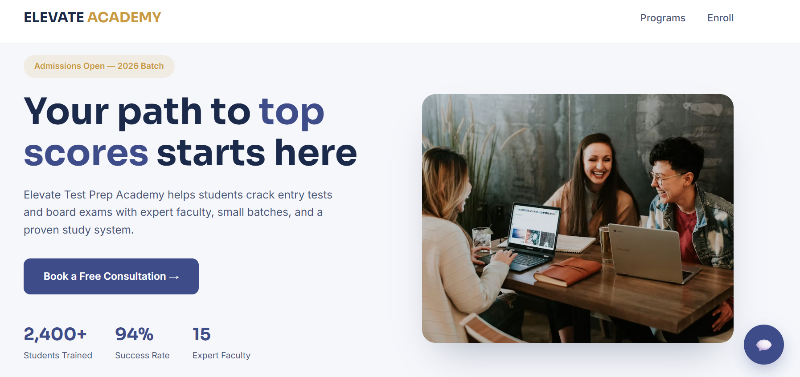

# 🎓 Elevate Test Prep Academy

A modern, responsive academy website designed to help students explore test preparation programs, tutoring options, and personalized academic mentoring.

## 🖥️ Live Preview 

🌐 **Live Demo:** [View Website](https://elevateacedamy.netlify.app/)

## ✨ Features

- Clean, modern educational website design
- Responsive layout for different screen sizes
- Programs for MDCAT, ECAT, and Cambridge O/A Levels
- One-on-one academic mentoring information
- Program pricing cards
- Student testimonials section
- Interactive FAQ accordion
- Free consultation enrollment form interface
- Interactive chat widget connected to an n8n webhook
- Chat window expand/collapse functionality

## 📚 Programs

- **MDCAT Preparation** — Syllabus coverage, weekly tests, and performance tracking
- **ECAT Preparation** — Problem-solving practice for engineering entry tests
- **O/A Level Tutoring** — Subject-focused tutoring for Cambridge examinations
- **1-on-1 Mentoring** — Personalized study plans and progress check-ins

## 🛠️ Technologies Used

- **HTML5** — Website structure and content
- **CSS3** — Styling, responsive layout, cards, and animations
- **JavaScript** — Chat widget interactions, FAQ accordion, and form behavior
- **n8n Webhook** — Chatbot communication
- **Google Fonts** — Sora and Inter typography
- **Unsplash** — Hero section image

## 🤖 AI Chatbot Integration

The website includes an interactive chat widget connected to an n8n webhook. Visitors can type questions or use quick prompts about program fees, batch timings, and contacting a person.

The chatbot requires the configured n8n workflow and webhook to be active to respond successfully.

## 🚀 Getting Started

1. Clone or download this repository.
2. Open the project folder.
3. Open `index.html` in your web browser.
4. To test chatbot functionality, make sure the n8n webhook and workflow are configured and active.

No package installation is required for this standalone HTML page.

## 📝 Project Note

The consultation form currently displays a confirmation message in the browser. A backend or form submission integration is required to send and store actual enrollment requests.

## 🎯 Project Goal

To create an engaging online presence for a test preparation academy, present educational programs clearly, and provide students with interactive ways to explore their study options.

## 👩‍💻 Author

**Fiza Batool**

- GitHub: [Fiza-batool](https://github.com/Fiza-batool)

---

*Elevate Test Prep Academy — Your path to top scores starts here.*

